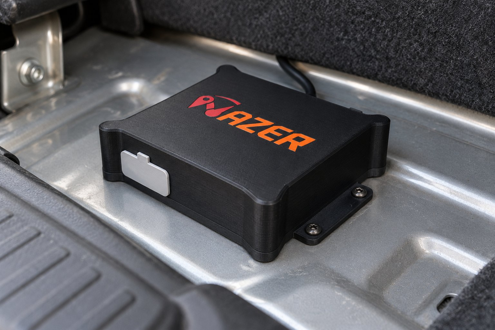
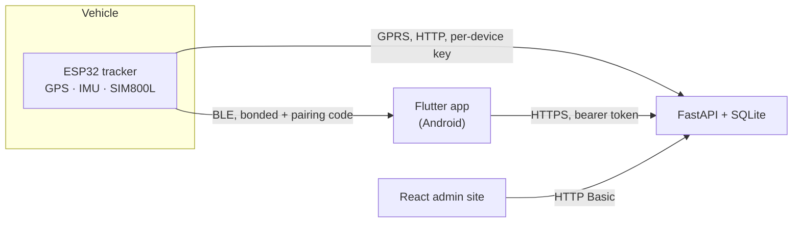
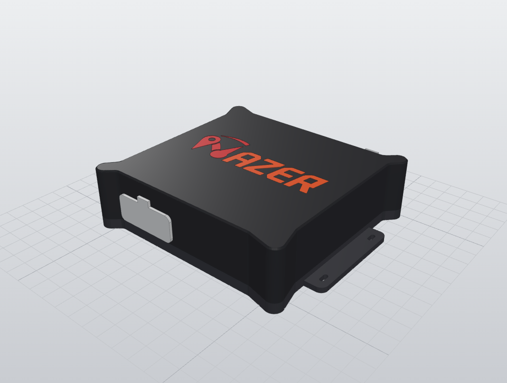
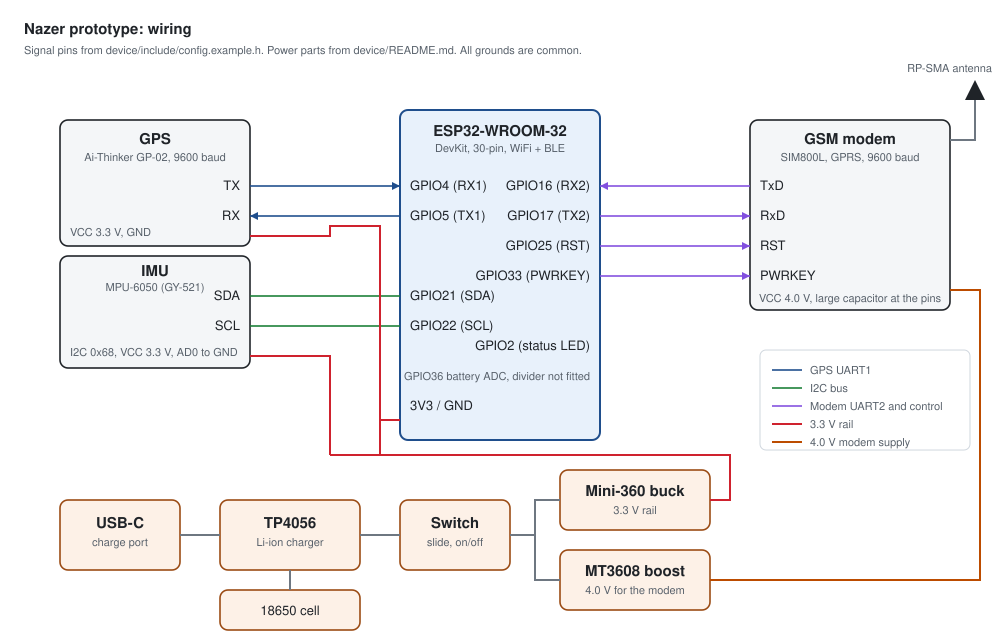

<div align="center">


# Nazer

**An open vehicle tracker you can build: ESP32 hardware, on-device speed limits, a phone app and a fleet dashboard.**

[](https://github.com/VINEX-Tech/nazer/actions/workflows/ci.yml)


[How it works](#how-it-works) · [Hardware](#hardware) · [Quick start](#quick-start) · [Status](#status) · [Roadmap](#roadmap)



<sub>Concept image of the planned fitting, not a photo of a built unit.</sub>

</div>

## Why Nazer

Most vehicle trackers are closed boxes that send everything to someone else's cloud. Nazer is the
whole stack in one repository: the board, the firmware, the server, the phone app and the admin
site, so a driver or a small fleet owner can see what the device knows and where the data goes.

## Highlights

- **Speed limits on the device.** The ESP32 looks up the road's limit from an OpenStreetMap pack
  stored in flash. No internet needed to know the limit.
- **Two links, one app.** Live speed over Bluetooth when the phone is near; live position from the
  server over GPRS when it is not.
- **Locked down by default.** BLE bonding with LE Secure Connections and a pairing code before any
  command, per-device upload keys, challenge-response device claim, bcrypt-hashed passwords and
  rate-limited sign-in.
- **Fleet view.** A React admin site with a live map, devices, drivers, violations and raw telemetry.
- **Printable enclosure.** A sealed PETG box with a TPU gasket and a two-colour logo, STLs included.

## How it works



The SIM800L modem has no TLS, so device uploads are plain HTTP signed with a per-device key. See
[SECURITY.md](SECURITY.md).

## Hardware

| Tracker box design | Wiring |
|---|---|
|  |  |

| Part | Used |
|---|---|
| Microcontroller | ESP32-WROOM-32 DevKit |
| GPS | Ai-Thinker GP-02 |
| Motion | MPU-6050 IMU |
| Cellular | SIM800L (GPRS), RP-SMA antenna |
| Power | 18650 cell, TP4056 USB-C charger, MT3608 boost for the modem, Mini-360 3.3 V buck, slide switch |
| Board | 102 x 80 mm perfboard, hand-wired |
| Enclosure | [`hardware/tracker-box`](hardware/tracker-box): printable STLs, part list, materials and design notes |

Pins are set in `device/include/config.example.h`. If a wire changes, change it there and in
[`hardware/wiring.svg`](hardware/wiring.svg).

## Quick start

```bash
git clone https://github.com/VINEX-Tech/nazer.git && cd nazer

# Firmware (PlatformIO)
cp device/include/config.example.h device/include/config.local.h   # fill in WiFi, server, keys
cd device && pio run && cd ..

# Backend
cp platform/.env.example platform/.env                              # fill in keys and admin login
cd platform/apps/api && pip install -r requirements-dev.txt && python -m pytest && cd ../../..

# App (Android)
cd app && flutter pub get && dart run build_runner build --delete-conflicting-outputs && flutter run
```

The app's generated files (`*.g.dart`, Hive adapters) are not committed, so run `build_runner` once
after cloning. Without `config.local.h` the firmware builds with placeholders: the server rejects
its uploads and it refuses every BLE command.

| File | Holds |
|---|---|
| `device/include/config.local.h` | WiFi, server host, device key, BLE passkey and pairing code |
| `platform/.env` | `NAZER_DEVICE_KEYS` (`DEVICE_ID:key` pairs), `NAZER_TOKEN_SECRET`, admin credentials, CORS |
| App Settings screen | Server URL, sign-in, device pairing code |

## Status

**Prototype / MVP.** It runs on one hand-built board and has not been road-tested.

| Part | Working now | How it is checked |
|---|---|---|
| Hardware | GPS fix, IMU, GPRS HTTP and BLE checked on the board in a bring-up on 2026-10-16 (`device/test/test_bringup.cpp`). The BLE bonding added later has not been run on the board yet. | Manual bring-up on the real board |
| Firmware | Speed-limit lookup, batched GPRS uploads, BLE bonding and pairing code, device claim | `pio run`, 6 host checks |
| Backend | Device uploads, live position and track, per-device keys, driver tokens, admin auth | pytest |
| Website | Live map, devices, drivers, violations, raw telemetry | node tests, `vite build` |
| App | Live speed over BLE, server position out of range, map, vehicle settings, sign-in | `flutter analyze`, widget and unit tests |
| Enclosure | Sealed tracker box, STLs in `hardware/tracker-box` | Base and spacers printed in PETG |

The fine payment screens in the app are a **demo**: no payment provider is connected and no money
moves. The screens say so.

| Known firmware limitation | State |
|---|---|
| Fusion tuning | Kalman noise values have not been tuned on a drive |
| Battery level | Reported but not measured: the ADC divider is not fitted |
| SMS commands | Present in firmware, only checked by sender number; see `SECURITY.md` |

## Roadmap

- [ ] Road test of the speed-violation logic
- [ ] Custom PCB to replace the perfboard
- [ ] Battery voltage divider fitted and measured
- [ ] TLS in front of the API
- [ ] Release signing key for the app

## Tests

Each command is what CI runs (`.github/workflows/ci.yml`).

| Component | Command | Result at v0.1.0 |
|---|---|---|
| Firmware | `cd device && pio run` | `nazer_esp32` and `bringup` build |
| Firmware host checks | `bash device/test/host/run_checks.sh` | 6 of 6 pass |
| API | `cd platform/apps/api && python -m pytest` | 47 passed |
| Website | `cd platform/apps/web && npm ci && npm test && npm run build` | 11 passed, build ok |
| App | `cd app && flutter analyze && flutter test` | no issues, 66 passed |

## Repository layout

| Folder | Contents |
|---|---|
| `device/` | ESP32 firmware (PlatformIO, Arduino), host checks in `test/host/`, bench test server |
| `hardware/` | Wiring diagram and enclosures: `tracker-box/` (current sealed box) and `enclosure/` (first parametric box, Python) |
| `platform/` | `apps/api` FastAPI backend, `apps/web` React admin site, Docker Compose and nginx config |
| `app/` | Flutter Android app |

## Security

See [SECURITY.md](SECURITY.md) for what is protected, what is not, and how to report a problem.

## License

Code: MIT, see [LICENSE](LICENSE). The road-limit pack `device/data/limits.bin` is derived from
OpenStreetMap data under the ODbL; see [NOTICE](NOTICE). Map tiles in the app and website come from
OpenStreetMap and show the required attribution.

## Author

Designed and built by **Abdel Rahman Mohamad EL-Sayed** ([@AbdelRahman-Madboly](https://github.com/AbdelRahman-Madboly)) as a [VINEX](https://github.com/VINEX-Tech) product.
