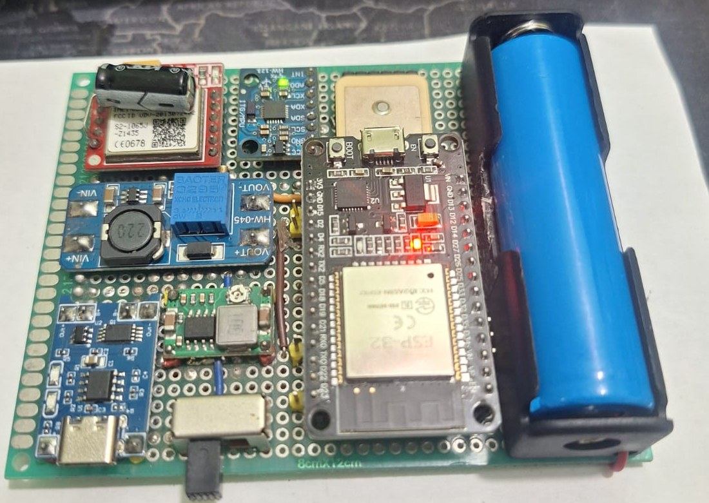

# Nazer

Nazer is a prototype vehicle tracker. An ESP32 board reads GPS and an IMU, looks up the road speed
limit on the device from an OpenStreetMap pack, uploads its position over GPRS to a FastAPI backend,
and talks to an Android app over Bluetooth Low Energy. An admin website shows devices and their live
position on a map.

**Status: Prototype / MVP.** It runs on one hand-built board and has not been road-tested.



## What works

| Part | What is shown to work | How it is checked |
|---|---|---|
| Hardware | ESP32 board on perfboard with GP-02 GPS, MPU-6050 IMU, SIM800L modem and BLE. GPS fix, IMU, GPRS HTTP and BLE checked on the board in a bring-up on 2026-10-16 (`device/test/test_bringup.cpp`). The BLE bonding added later has not been run on the board yet. | Manual bring-up on the real board |
| Firmware | Builds for ESP32. On-device speed-limit lookup from an OpenStreetMap pack, batched GPRS uploads, BLE bonding (LE Secure Connections, passkey) and a pairing code before any command, challenge-response device claim. | `pio run`, 6 host checks |
| Backend | FastAPI + SQLite. Receives device uploads, serves live position and track to the app and website. Per-device keys, driver bearer tokens, bcrypt-hashed passwords, challenge-response device claim, rate-limited sign-in, HTTP Basic admin auth. | 43 pytest tests |
| Website | React admin pages: live tracking map, devices, drivers, violations, raw telemetry. | 11 node tests, `vite build` |
| App | Flutter (Android). Live speed over BLE, live position from the server when out of BLE range, map, vehicle settings. Sign-in for Internet tracking, BLE pairing code. | `flutter analyze`, 66 tests |
| Enclosure | Printed parametric box (PETG) for the board, battery and antenna. | Printed in PETG |

The fine payment screens in the app are a **demo**: no payment provider is connected and no money
moves. The screens say so.

## Not built yet

- A custom PCB. The prototype is hand-wired on perfboard. Schematic work so far covers only the power
  stage and is not part of this repo.
- A road test. The firmware has speed-violation logic, but it has not been tried on real roads.
- A release signing key for the app (release builds use debug signing).
- TLS in front of the API, and battery voltage measurement (the divider is not fitted on the board).

## Repository layout

| Folder | Contents |
|---|---|
| `device/` | ESP32 firmware (PlatformIO, Arduino), host checks in `test/host/`, bench test server |
| `hardware/` | Enclosures: `tracker-box/` (current sealed box, STLs and render) and `enclosure/` (first parametric box, Python) |
| `platform/` | `apps/api` FastAPI backend, `apps/web` React admin site, Docker Compose and nginx config |
| `app/` | Flutter Android app |
| `docs/` | Board photo |

```
ESP32 device --BLE (bonded + pairing code)--> Flutter app --HTTPS, bearer token--> API
     |                                                                    ^
     +--------GPRS, plain HTTP, per-device key (SIM800L has no TLS)-------+
                                                                          |
                                         Admin website --HTTP Basic-------+
```

## Build and test

Each command below is what CI runs (`.github/workflows/ci.yml`).

| Component | Commands | Result at v0.1.0 |
|---|---|---|
| Firmware | `cd device && pio run` | `nazer_esp32` and `bringup` build |
| Firmware host checks | `bash device/test/host/run_checks.sh` | 6 of 6 pass |
| API | `cd platform/apps/api && pip install -r requirements-dev.txt && python -m pytest` | 47 passed |
| Website | `cd platform/apps/web && npm ci && npm test && npm run build` | 11 passed, build ok |
| App | `cd app && flutter pub get && dart run build_runner build --delete-conflicting-outputs && flutter analyze && flutter test` | no issues, 66 passed |

The app's generated files (`*.g.dart`, Hive adapters) are not committed. Run `build_runner` once
after cloning, as above, or the app will not compile.

## Configuration

Nothing secret is committed. Copy the example files and fill them in:

| File | Holds |
|---|---|
| `device/include/config.local.h` (from `config.example.h`) | WiFi, server host, device key, BLE passkey and pairing code |
| `platform/.env` (from `.env.example`) | `NAZER_DEVICE_KEYS` (`DEVICE_ID:key` pairs), `NAZER_TOKEN_SECRET`, admin credentials, CORS |
| App Settings screen | Server URL, sign-in, device pairing code |

Without `config.local.h` the firmware builds with placeholders: the server rejects its uploads and
it refuses every BLE command.

## Known firmware limitations

| Item | State |
|---|---|
| `KalmanSpeedFilter::getCovariance()` returned an unrelated macro value (`_P`) | Fixed in v0.1.0 |
| Telemetry sent the fused speed as `speed_imu_kmh`, so the two columns were always equal | Fixed: the field is no longer sent, the server stores it as empty |
| Fusion tuning | Kalman noise values have not been tuned on a drive |
| Battery level | Reported but not measured: the ADC divider is not fitted |
| SMS commands | Present in firmware, only checked by sender number; see `SECURITY.md` |

## Security

See [SECURITY.md](SECURITY.md) for what is protected, what is not, and how to report a problem.

## License

Code: MIT, see [LICENSE](LICENSE). The road-limit pack `device/data/limits.bin` is derived from
OpenStreetMap data under the ODbL; see [NOTICE](NOTICE). Map tiles in the app and website come from
OpenStreetMap and show the required attribution.

## Author

Designed and built by Abdel Rahman Mohamad EL-Sayed ([AbdelRahman-Madboly](https://github.com/AbdelRahman-Madboly) on GitHub) as a VINEX product.
