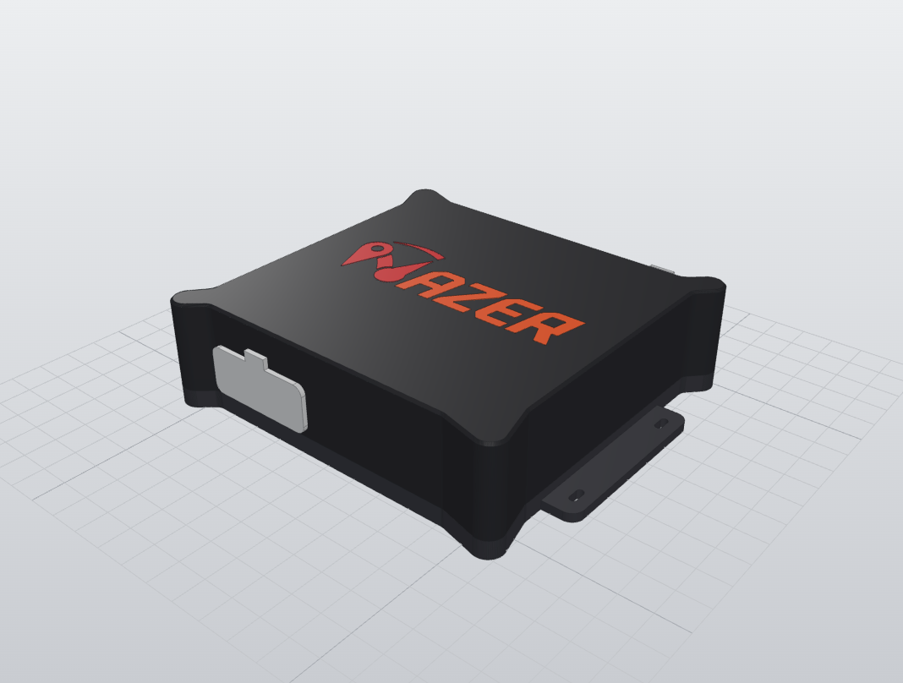
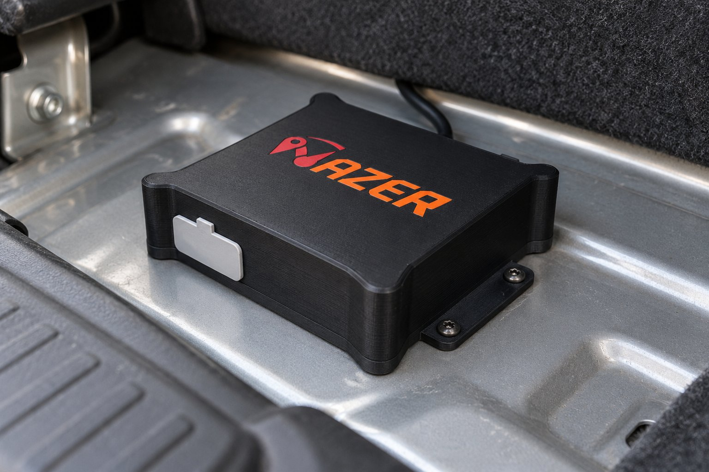

# Nazer tracker box

Sealed 3D-printed enclosure for the Nazer prototype board, its 18650 cell and the RP-SMA antenna.
It replaces the first enclosure in [`../enclosure`](../enclosure). Part of the Nazer monorepo; see
the [root README](../../README.md).

| Design | Fitted in a car boot |
|---|---|
|  |  |

The second picture is a concept image of the planned fitting, not a photo of a built unit.

## Status

Design prototype (assembly version v013). Outer size about 133 x 116 x 35 mm including the
mounting lugs. Print files are oriented for printing.

## Printed parts

| File | Part | Material |
|---|---|---|
| `stl/base.stl` | Base plate with mounting lugs | black PETG |
| `stl/lid.stl` | Lid, printed top down, with captured M3 nut pockets | black PETG |
| `stl/logo-mark.stl`, `stl/logo-arc.stl`, `stl/logo-pin.stl` | Logo mark inlay | red PLA (second colour) |
| `stl/logo-text.stl` | Logo text inlay | orange PLA (second colour) |
| `stl/gasket.stl` | Seam gasket, printed flat | TPU 95A |
| `stl/port-plug.stl` | Plug for the USB-C and switch window | TPU 95A |
| `stl/gland-plug.stl` | Blanking plug for the spare wire hole; swap for a PG7 gland when a wire is added | TPU 95A |
| `stl/spacers.stl` | PCB edge spacers | black PETG |
| `stl/nut-gauge.stl` | Test coupon to check the nut pocket fit before printing the lid | black PETG |

## Design notes

- The closing screws sit in corner lugs outside the gasket loop, so water cannot follow a screw
  shank into the box.
- The PLA logo inlays have a 0.4 mm wider flange under the surface layer because PLA does not bond
  to PETG.
- PCB locators are separate solid spacers. Thin printed ribs on an earlier base broke.
